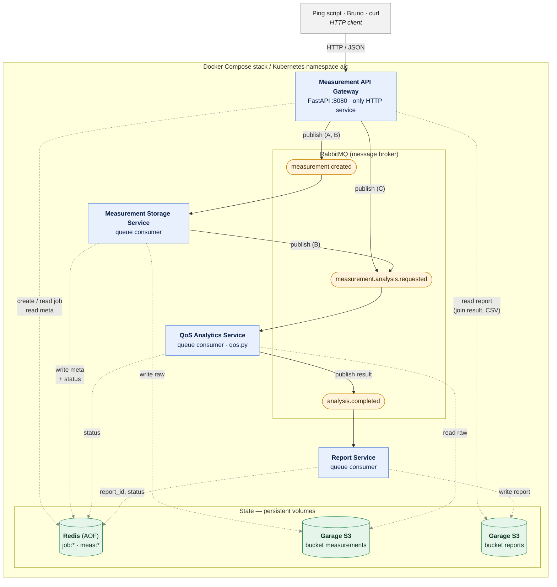

# Architecture — Containerized Network Measurement and Analytics Pipeline

**Legend:** solid arrows = messages (HTTP and RabbitMQ), dotted grey arrows = state reads/writes. (A), (B), (C) = the workflow that uses the edge.

**Job paths:** Workflow A = `queued → completed`, B = `queued → stored → analyzed → completed`, C = `queued → analyzed → completed`.

## Components and their roles

### Client
- **Ping script (`scripts/measurement_simulator.py`), Bruno, curl** — Simulate network hosts and send latency measurements to the Gateway. They are not part of the system; they only use its public HTTP API.

### Application services (Python, one image and one process each, stateless)
- **Measurement API Gateway** — The single entry point and the only service that speaks HTTP. It validates requests, mints `measurement_id` and `job_id`, saves the job as `queued` in Redis *before* publishing, and publishes to `measurement.created` (Workflows A/B) or `measurement.analysis.requested` (Workflow C). It answers 202 immediately and never writes a measurement, analysis or report. On reads it joins the job state from Redis with the report from Garage and renders CSV on demand. Returns 400 / 404 / 503 for invalid body / unknown id / failed publish (and deletes the job again on 503).
- **Measurement Storage Service** — Consumes `measurement.created`. Writes the raw measurement as immutable JSON to the `measurements` bucket and is the only writer of the measurement metadata (`meas:<id>`). Marks the job `completed` (A), or `stored` and forwards an analysis request to `measurement.analysis.requested` (B).
- **QoS Analytics Service** — Consumes `measurement.analysis.requested`. Reads the raw measurement from Garage, computes the QoS indicators we implement (e.g. average/min/max latency, jitter, packet loss, threshold anomaly) and the `nominal / degraded / critical` classification, sets the job to `analyzed` and publishes the result to `analysis.completed`. It persists nothing itself.
- **Report Service** — Consumes `analysis.completed`. Derives `r-x` from `m-x`, stores the report with the analysis embedded in the `reports` bucket (overwriting the same object on re-analysis, which makes duplicates impossible), then writes `report_id` and `completed` to the job.

### Messaging
- **RabbitMQ** — Decouples the stages so the Gateway never waits for processing and each stage can be scaled or restarted independently. Delivery is at-least-once, so every consumer must be idempotent. Each consumer reads exactly one queue and publishes to at most one.
  - `measurement.created` — Gateway → Storage
  - `measurement.analysis.requested` — Storage (B) or Gateway (C) → Analytics
  - `analysis.completed` — Analytics → Report
  - `measurement.failed` — optional error queue, no consumer

### State stores (persistent volumes)
- **Redis** — Shared, mutable state that keeps the services stateless: job hashes (`job:<id>`: `measurement_id`, `status`, `report_id`) and measurement metadata (`meas:<id>`). Services update only the fields they own (`HSET`), and the job only *references* its report. Runs with append-only persistence on a volume.
- **Garage (S3-compatible object store)** — Durable artifacts: raw measurements in `measurements` (immutable) and report documents in `reports` (one per measurement, JSON only — no CSV is stored). Accessed through a provider-agnostic S3 client (`boto3`). Runs in single-node mode, which applies the layout and imports the shared S3 key on startup; the one-shot `garage-init` container (a Kubernetes Job on the cluster) creates the buckets.

## Who writes what

| State | Written by | Read by |
|---|---|---|
| `job:<id>` create / delete, `status=queued` | Gateway | Gateway |
| `job:<id>` `status` (`stored`, `completed` for A, `failed_measurement_storage`) | Storage | Gateway |
| `job:<id>` `status` (`analyzed`, `failed_analysis`) | Analytics | Gateway |
| `job:<id>` `report_id`, `status` (`completed` for B/C, `failed_report_storage`) | Report | Gateway |
| `meas:<id>` metadata | Storage | Gateway (and Analytics for `object_path`, if agreed) |
| `measurements` bucket (raw JSON) | Storage | Analytics |
| `reports` bucket (report + embedded analysis) | Report | Gateway |
